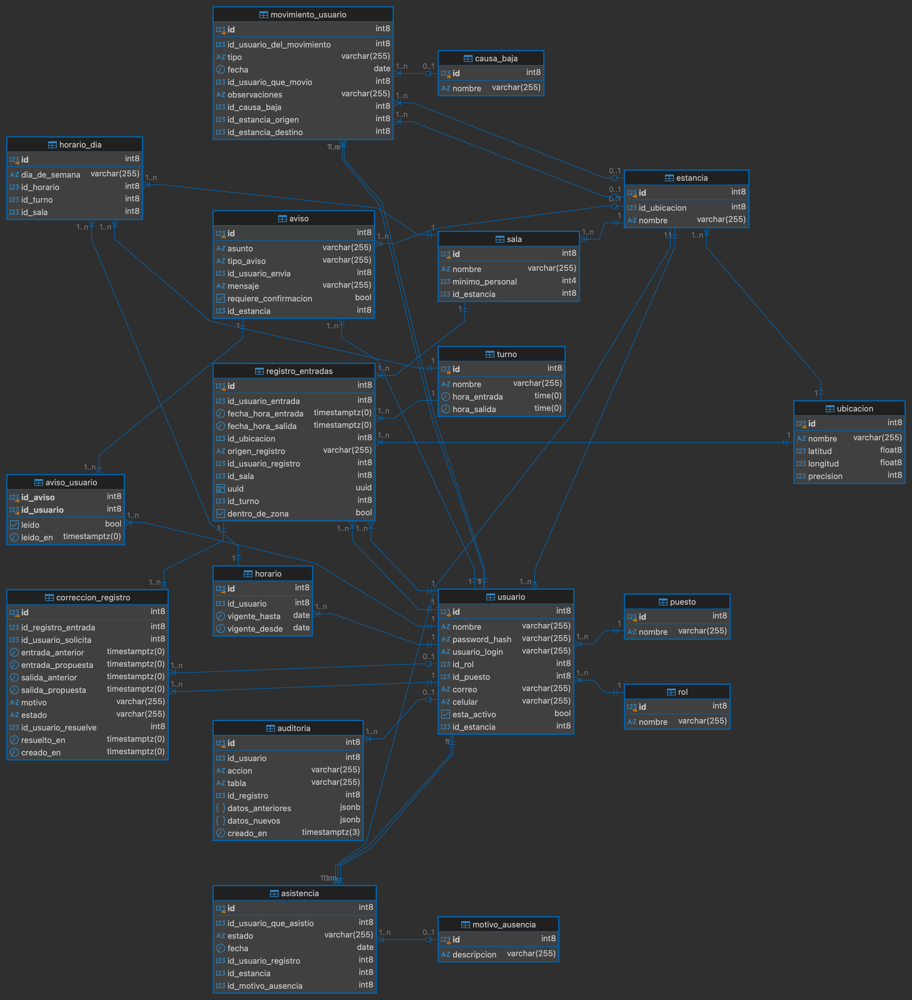
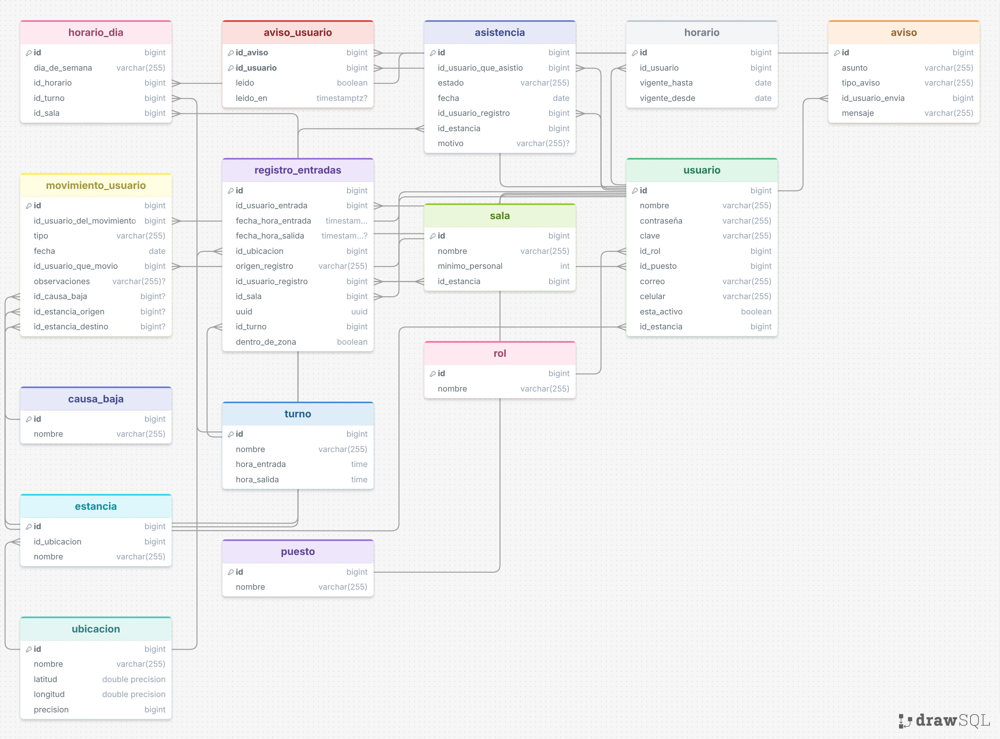

# Sonrisas Cristal DB

PostgreSQL 17 + pgAdmin 4 en Docker, con datos persistentes.

## Requisitos

- [Docker Desktop](https://www.docker.com/products/docker-desktop/) abierto y corriendo.

## Estructura

| Archivo | Para qué sirve |
|---|---|
| `Dockerfile` | Imagen de Postgres (`postgres:17`) + scripts de inicio |
| `docker-compose.yml` | Levanta Postgres y pgAdmin juntos, con volúmenes |
| `.env` | Usuarios, contraseñas y puertos (no se sube a git) |
| `init/*.sql` | Scripts que corren **solo la primera vez** que se crea la BD |
| `pgadmin-servers.json` | Registra el servidor automáticamente en pgAdmin |

## Cómo correr

```bash
# 1. (Opcional) edita las contraseñas en .env
# 2. Descargar imágenes, construir y levantar en segundo plano
docker compose up -d --build
```

Espera ~30–60 s la primera vez (pgAdmin tarda en iniciar).

## Acceso

**pgAdmin (editor web):** http://localhost:5050

- Email: `admin@admin.com`
- Contraseña: `admin123`
- El servidor "Sonrisas Cristal" ya aparece registrado. Al conectar, pide la contraseña de Postgres (`POSTGRES_PASSWORD` de `.env`).

**Postgres:** no se publica ningún puerto en tu PC. Solo es accesible dentro de la red de Docker `sonrisas_net`, donde se llama `postgres` (puerto `5432`). Se conectan así:

- **pgAdmin** (ya registrado): host `postgres`, usuario `postgres`, contraseña `POSTGRES_PASSWORD` de `.env`.
- **La API** (repo `sonrisas_cristal_api`): se une a `sonrisas_net` y usa `api_user` con `API_DB_PASSWORD` de `.env`. Prende primero esta base y luego la API.
- **Consola SQL:** `docker exec -it sonrisas_postgres psql -U postgres -d sonrisas_cristal`.

> Si necesitas una herramienta externa (DBeaver, etc.), agrega temporalmente `ports: ["5432:5432"]` al servicio `postgres` en `docker-compose.yml`.

## Persistencia de datos

Los datos viven en volúmenes de Docker (`postgres_data` y `pgadmin_data`), no dentro del contenedor. Sobreviven a:

- apagar o reiniciar la PC (los contenedores tienen `restart: unless-stopped`),
- `docker compose stop` / `docker compose down`.

> ⚠️ **Se borran solo si** ejecutas `docker compose down -v` o `docker volume rm ...`. No uses `-v` a menos que quieras empezar de cero.

## Comandos útiles

```bash
docker compose up -d          # iniciar
docker compose stop           # pausar (conserva todo)
docker compose down           # apagar y quitar contenedores (conserva datos)
docker compose logs -f        # ver logs
docker compose ps             # ver estado

# Consola SQL
docker exec -it sonrisas_postgres psql -U postgres -d sonrisas_cristal

# Respaldo
docker exec sonrisas_postgres pg_dump -U postgres sonrisas_cristal > respaldo.sql

# Restaurar
docker exec -i sonrisas_postgres psql -U postgres -d sonrisas_cristal < respaldo.sql
```

## Tablas iniciales

El esquema completo (tablas, llaves foráneas, restricciones y auditoría) está en `init/01-init.sql`. Solo se ejecuta cuando el volumen está vacío. Para reaplicarlo desde cero (borra los datos):

```bash
docker compose down -v
docker compose up -d --build
docker compose logs postgres | grep -i error   # debe salir vacío
```

Cada quien tiene su propia base local: si alguien cambia el `init/`, los demás deben hacer `git pull` y repetir esos comandos para ver el cambio.

> `motivo_ausencia` y los demás catálogos (`rol`, `puesto`, `turno`, etc.) se crean **vacíos**. Hay que cargarlos antes de registrar, por ejemplo, una falta o incidencia (que exigen un motivo).

## Para la API (cambios del esquema)

Si mantienes `sonrisas_cristal_api`, esto es lo que debes saber:

### 1. Auditoría: fijar el autor en cada transacción

Las tablas `registro_entradas` y `asistencia` se auditan solas con triggers y guardan el resultado en `auditoria` (append-only; `api_user` solo puede leerla). Para que quede **quién** hizo el cambio, la API debe ejecutar esto al inicio de **cada transacción que escriba**, con el id del usuario del JWT:

```sql
BEGIN;
SET LOCAL app.id_usuario = 'id';
-- ...INSERT / UPDATE aquí...
COMMIT;
```

- `SET LOCAL` solo vale dentro de una transacción; fuera de ella no hace efecto. Con pool de conexiones, siempre abre la transacción explícitamente.
- Si no se fija, el cambio se audita igual pero con `id_usuario` en `NULL`.
- La hora de la auditoría la pone el servidor de base de datos, no la app.

### 2. Columnas renombradas o nuevas

| Antes | Ahora |
|---|---|
| `usuario.contraseña` | `usuario.password_hash` (guardar **hash**, nunca texto plano) |
| `usuario.clave` | `usuario.usuario_login` |
| `asistencia.motivo` (texto) | `asistencia.id_motivo_ausencia` (id de `motivo_ausencia`) |
| `motivo_ausencia.nombre` | `motivo_ausencia.descripcion` |

Nuevo en `aviso`: `requiere_confirmacion` (booleano) e `id_estancia` (`NULL` = aviso general). Los destinatarios siguen en `aviso_usuario`; la API crea una fila por destinatario.

### 3. Tablas nuevas

- **`auditoria`:** solo lectura para `api_user`.

### 4. Reglas que la base ya valida

`falta` e `incidencia` exigen `id_motivo_ausencia`; una sola asistencia por persona, estancia y día; `registro_entradas.uuid` es único (reenviar el mismo registro offline falla por duplicado: la API debe tratarlo como ya recibido, por ejemplo con `ON CONFLICT (uuid) DO NOTHING`).

## Cambiar usuario/contraseña/base

`POSTGRES_USER`, `POSTGRES_PASSWORD` y `POSTGRES_DB` solo se aplican cuando se crea el volumen por primera vez. Si ya existe, cambia la contraseña con SQL (`ALTER USER postgres PASSWORD '...';`) o recrea el volumen. Si cambias `POSTGRES_USER` o `POSTGRES_DB`, actualiza también `pgadmin-servers.json`.

## Problemas comunes

- **Puerto ocupado:** cambia `POSTGRES_PORT` o `PGADMIN_PORT` en `.env`.
- **pgAdmin no carga:** espera un minuto y revisa `docker compose logs pgadmin`.


# DIAGRAMA DE BASE DE DATOS

## v2 (actual)

17 tablas. Incluye `motivo_ausencia` y `auditoria`.



## v1 (anterior)

Versión previa a los últimos cambios del esquema; se conserva solo como referencia.


